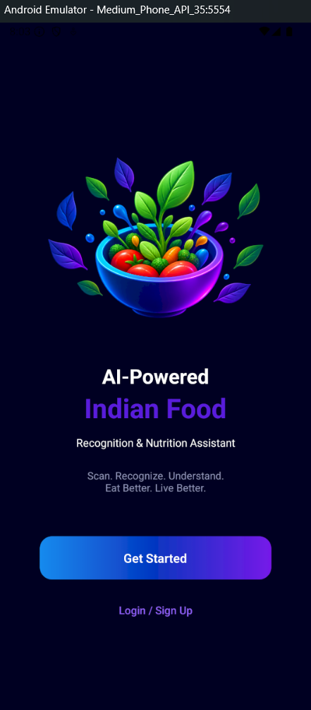
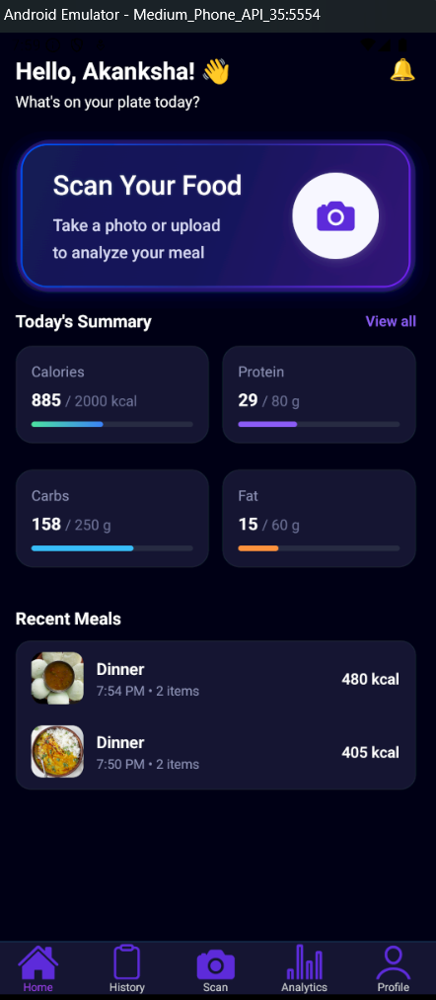
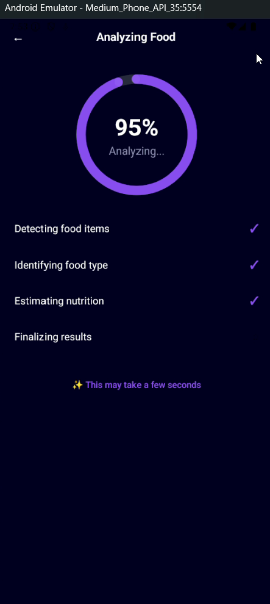
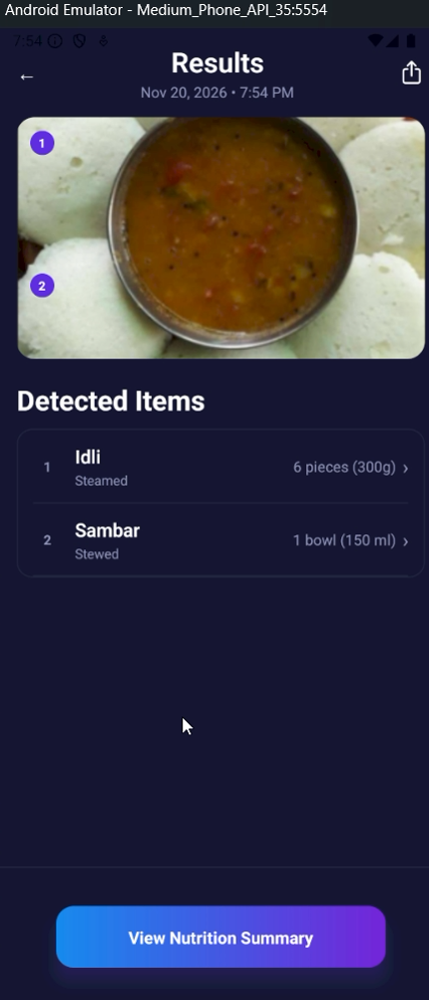
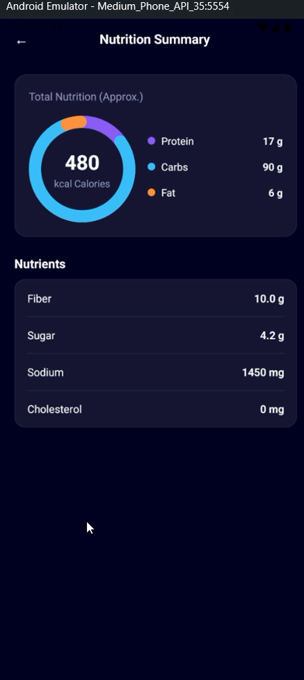
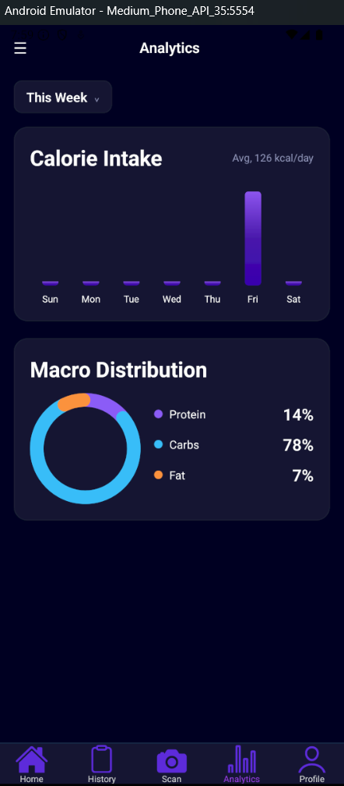

# Indian Food Recognition & Nutrition App

## About the Project
NutriVLM is an AI-powered food recognition and nutrition analysis application designed to help users understand the nutritional value of their meals. The application uses computer vision and AI-based analysis to identify food items from images and provide estimated nutritional information.

The main goal of NutriVLM is to make daily food tracking easier, smarter, and more accessible, with a special focus on Indian food items.

## Features
- Food analysis
- Track dietary information
- User Authentication
- Nutrition Analysis
- Database Integration

## Tech Stack
- Frontend: React.js
- Backend: Node.js, Express.js
- Database: MongoDB
- API Testing: Postman

## Application Screenshots

### Landing page

### Home page

### Food Analysis Page

### Result page

### Summary page

### Analytics page

## Developed By
Akanksha Bhame